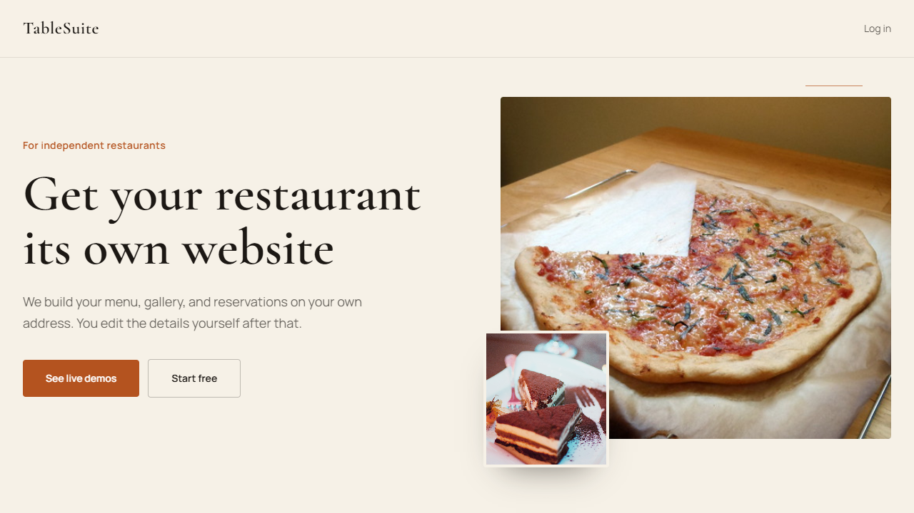
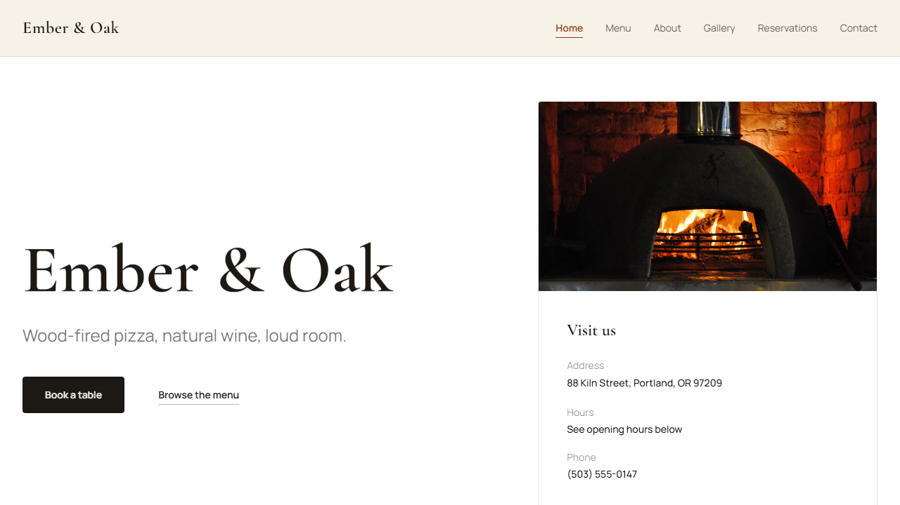
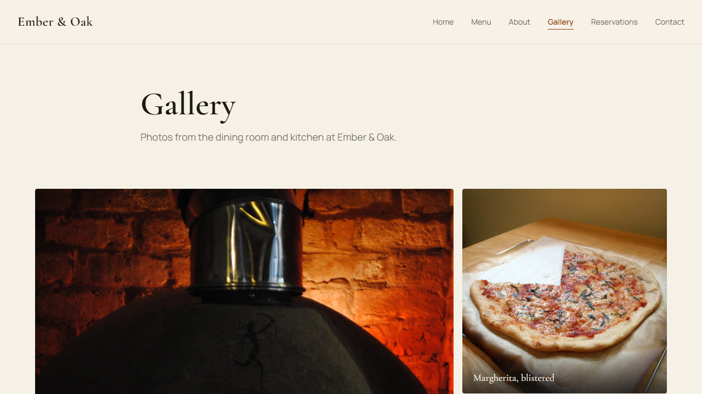
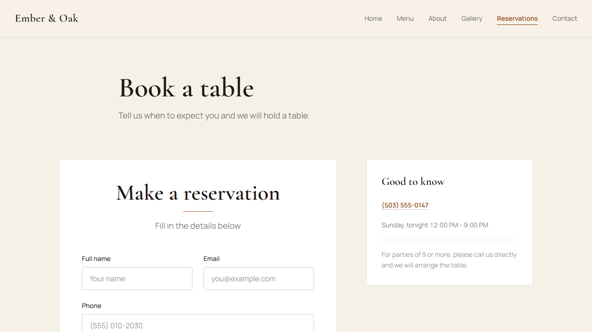

<p align="center">
  
</p>

<p align="center">
  
  
  
  
  
  
</p>

<p align="center">
  <b>Multi-tenant</b> · <b>Row Level Security</b> · <b>Edge Functions</b> · <b>47 tests</b> · <b>No server to run</b>
</p>

---

**TableSuite** is a multi-tenant website builder for independent restaurants. A restaurant owner signs up, goes through a short onboarding, and gets their **own public site**: menu, gallery, reservations and contact. They manage it all from an admin dashboard. Every restaurant's data stays private from the others, enforced by the database itself.

<p align="center">
  
  
</p>

## ✨ Features

**For restaurant owners**
- 🚀 **Sign up → onboarding → live site.** Each restaurant gets its own site at `/site/<slug>`
- 🍽️ **Menu manager:** categories, dishes, prices
- 🖼️ **Gallery manager:** upload photos to Supabase Storage, publish or hide them
- 📅 **Reservations inbox** and 💬 **contact inbox**, with **email notifications** for new requests
- ⚙️ **Restaurant settings:** name, address, hours, phone

**For their guests**
- A clean, fast public site: Home · Menu · About · Gallery · Reservations · Contact
- Gallery lightbox, scroll-driven chapters, reveal animations and a mobile-first layout

**Under the hood**
- 🔒 **Row Level Security** keeps tenants apart, enforced by Postgres, not by app code
- 🪝 **Notifications fire from Postgres webhooks** → Edge Functions → email, so they work even if someone skips the UI
- 🛡️ **Production hardening:** a locked-down RPC, guards against status forgery, storage policies and a notification delivery log
- 🧊 **3D pizza hero** on the landing page, built with React Three Fiber

<p align="center">
  
  
</p>

## 🏗️ Architecture

```
Browser (React SPA)
   │  supabase-js (anon key, RLS applies)
   ▼
Supabase ── Postgres (schema + RLS + RPC) ── Storage (gallery photos)
   │  database webhook on new reservation / message
   ▼
Edge Functions (notify-reservation, notify-contact-message) ──▶ Resend email
```

- **Tenancy is path-based** (`/site/<slug>/...`), so no wildcard DNS or certificates are needed. Moving to subdomains only means changing the slug lookup in `src/context/TenantContext.jsx`.
- **No backend server.** The app builds to static files and runs on Vercel, Netlify or any static host. `vercel.json` and `public/_redirects` handle deep links.

```
tablesuite/
├── src/
│   ├── pages/            public site · admin/ · auth/ · onboarding/ · marketing/
│   ├── components/       Navbar · ScrollChapters · PizzaScene · SteamCanvas · Reveal…
│   ├── context/          Auth · Tenant · AdminTenant
│   ├── hooks/            useMenu · useGallery
│   └── layouts/          TenantLayout · AdminLayout
├── supabase/
│   ├── migrations/       0001 schema+RLS → 0006 analytics & gallery publishing
│   ├── functions/        email notification Edge Functions
│   └── seed*.mjs         demo tenants: The Golden Fork, Ember & Oak
└── public/               favicon, icons, static-host redirects
```

## 🚀 Getting started

**Requirements:** Node 20+, a [Supabase](https://supabase.com) project (or the Supabase CLI for a local stack)

```sh
git clone https://github.com/wadiiagurbi/tablesuite.git
cd tablesuite
npm install
cp .env.example .env.local   # add your Supabase URL + anon key
```

**1. Database:** link your project and run the migrations

```sh
supabase link --project-ref <your-project-ref>
supabase db push
```

**2. Email notifications** (optional). Deploy the functions and set their secrets:

```sh
supabase functions deploy notify-reservation --no-verify-jwt
supabase functions deploy notify-contact-message --no-verify-jwt
supabase secrets set EDGE_FUNCTION_SHARED_SECRET=<random-secret> RESEND_API_KEY=<key> RESEND_FROM=<sender>
```

Then store the same secret and your project URL in Supabase Vault, so the database webhooks can call the functions:

```sql
select vault.create_secret('https://<your-project-ref>.supabase.co', 'project_url');
select vault.create_secret('<random-secret>', 'edge_function_key');
```

> Use a dedicated secret (`openssl rand -hex 32`), never the anon key. Without `RESEND_API_KEY`, the functions log the email instead of sending it.

**3. Demo data** (optional)

```sh
SUPABASE_URL=... SUPABASE_SERVICE_ROLE_KEY=... npm run seed
```

**4. Run it**

```sh
npm run dev
```

Open `/` for the landing page, `/site/golden-fork` for the demo restaurant, or sign up at `/signup` to create your own.

## 🧪 Scripts

```sh
npm run dev      # dev server
npm test         # 47 Vitest + Testing Library tests
npm run lint     # oxlint
npm run build    # static build → dist/
npm run check    # lint + test + build
```

## 🗺️ Roadmap

- 💳 Billing and subscriptions
- 🌐 Subdomains and custom domains per restaurant
- ⚙️ CI/CD

---

<p align="center">
  My first full SaaS 🍕 Made by <a href="https://github.com/wadiiagurbi">wadiiagurbi</a> · MIT License
</p>

<p align="center">
  
</p>
